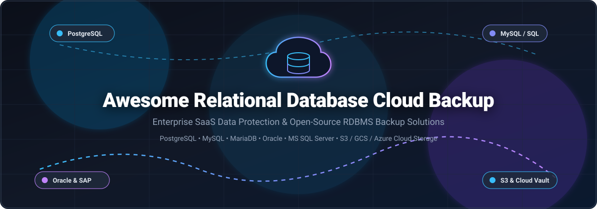

# 🛡️ Awesome Relational Database Cloud Backup ☁️

  
  
  
  
  
  

  <strong>A curated directory of enterprise SaaS cloud backup platforms and battle-tested open-source solutions for relational database management systems (RDBMS) — including PostgreSQL, MySQL, MariaDB, Oracle Database, and Microsoft SQL Server.</strong>

  ⭐ <strong>Star this repository if you find it valuable!</strong> ⭐

---

## 📑 Table of Contents

- [📊 Sector Overview & Market Dynamics](#-sector-overview--market-dynamics)
- [🏢 SaaS & Hosted Commercial Platforms](#-saas--hosted-commercial-platforms)
- [💻 Open-Source Database Backup Solutions](#-open-source-database-backup-solutions)
  - [1. 📦 Backup](#1--backup)
  - [2. 🐘 pgBackRest](#2--pgbackrest)
  - [3. 🚀 WAL-G](#3--wal-g)
  - [4. 🍸 Barman](#4--barman)
  - [5. ⚡ MyDumper](#5--mydumper)
  - [6. 🚪 Portabase](#6--portabase)
  - [7. 🛠️ Percona XtraBackup](#7-️-percona-xtrabackup)
  - [8. 🐳 Docker PostgreSQL Backup Local](#8--docker-postgresql-backup-local)
  - [9. 🦭 Mariabackup](#9--mariabackup)
  - [10. 🔒 DBackup](#10--dbackup)
  - [11. 🇳🇱 Holland Backup](#11--holland-backup)
- [🔍 Comprehensive Comparison Matrix](#-comprehensive-comparison-matrix)
- [💖 Support & Sponsorship](#-support--sponsorship)
- [📈 Star History](#-star-history)
- [🤝 Contributing](#-contributing)
- [📄 License](#-license)

---

## 📊 Sector Overview & Market Dynamics

The global cloud backup and relational database disaster recovery market is estimated at approximately **$14.5 billion in 2024–2025** and is projected to surpass **$35 billion by 2030**, expanding at a robust CAGR of ~15–18% driven by exponential data explosion, stringent data governance mandates (GDPR, HIPAA, SOC 2), and escalating ransomware threats against critical stateful database workloads.

The market structure is **moderately fragmented across tiers but concentrated at the enterprise summit**, where a dominant cohort of incumbent giants and pure-play cybersecurity/data resilience platforms (such as Veeam, Commvault, Rubrik, Cohesity, and Druva) command the bulk of enterprise IT budgets through proprietary deduplication, zero-trust air-gapped vaults, and certified application plugins. Concurrently, high-velocity mid-market startups and database-native open-source utilities (like pgBackRest, WAL-G, and Portabase) capture significant developer adoption and infrastructure-as-code automation workflows, preventing a monolithic winner-take-all monopoly across the entire stack.

---

## 🏢 SaaS & Hosted Commercial Platforms

Below is an overview of leading commercial SaaS and enterprise data protection platforms for relational databases, ranked in descending order by company valuation / annual revenue scale:

| 🏢 Platform | 💰 Company Valuation / Revenue | 🏷️ Specific Starting Pricing | 🎁 Free Tier / Free Trial Limits | 🗄️ Supported RDBMS Engines | ☁️ Cloud & Architecture Highlights |
| :--- | :--- | :--- | :--- | :--- | :--- |
| **[Veeam Backup & Replication](https://www.veeam.com/)** | **~$1.5B+ ARR** (Valued at ~$5B+, Insight Partners) | **$1,020/year** (Veeam Data Platform Foundation, 10-workload bundle ~$102/workload/yr) | **Community Edition:** Free forever for up to **10 workloads/instances**; 30-day full-feature trial | SQL Server, PostgreSQL, Oracle RMAN, SAP HANA, IBM Db2, Azure SQL, AWS RDS | Application-consistent snapshots, certified Oracle SBT and SAP HANA backends, immutable Linux repositories. |
| **[Commvault Cloud](https://www.commvault.com/)** | **~$3.9B Market Cap** (NASDAQ: CVLT, ~$890M+ ARR) | **~$3.50/workload/month** (or ~$42/workload/year base; AWS Marketplace starting tier) | **30-day free trial** with full enterprise feature set (up to 5 TB protected data) | 50+ database engines including Oracle, MS SQL Server, PostgreSQL, MySQL, MariaDB, SAP HANA, Azure SQL | Metallic-powered cyber resilience, IntelliSnap hardware integration, multi-cloud S3/Azure air-gapped storage. |
| **[Rubrik Database Protection](https://www.rubrik.com/)** | **~$8.5B Market Cap** (NYSE: RBRK, ~$800M+ ARR) | **~$2,500/node/year** (Enterprise Pro Edition base subscription) | **30-day proof-of-concept (PoC) / free trial** via guided cloud lab or virtual appliance | Oracle RAC/ASM, Microsoft SQL Server, PostgreSQL, MySQL, SAP HANA | Zero Trust Data Security, immutable append-only filesystem (Atlas), instant Live Mount recovery, native VSS. |
| **[Cohesity Database Protection](https://www.cohesity.com/)** | **~$7.0B Valuation** (Post-Veritas Data Protection acquisition) | **~$1,800/node/year** (Base DataProtect software licensing tier) | **30-day free trial** of Cohesity DataProtect as a Service (hosted cloud environment) | Oracle Database (RMAN certified), Microsoft SQL Server, SAP HANA, PostgreSQL | Hyper-converged secondary storage, instant mass restore, multi-cloud automated tiering and cyber scanning. |
| **[Druva Data Resiliance Cloud](https://www.druva.com/)** | **~$2.0B Valuation** (~$250M+ ARR) | **$2.50 per 100 GB/month** (~$0.025/GB/mo on AWS Marketplace starting tier) | **30-day free trial** with up to **1 TB of AWS cloud backup storage** included | Microsoft SQL Server, SAP HANA, Oracle (hybrid), AWS RDS Aurora/PostgreSQL | 100% serverless SaaS built natively on AWS, automated 5–120 minute transaction log backups, air-gapped storage. |
| **[Bacula Enterprise](https://www.baculasystems.com/)** | **~$50M Valuation** (Privately held, Bacula Systems) | **$2,995/year** (Bacula Enterprise Standard subscription tier for up to 20 clients) | **30-day free trial** of Bacula Enterprise with selected database plugins (Oracle, PostgreSQL, MySQL) | MySQL/MariaDB (Percona XtraBackup & Mariabackup), PostgreSQL, Oracle RMAN, MS SQL Server | Enterprise open-core architecture, no data volume surcharges, point-in-time binary log recovery. |

---

## 💻 Open-Source Database Backup Solutions

The open-source ecosystem offers powerful options ranging from versatile full-stack multi-database managers to engine-specific continuous archiving and hot-backup tools. The tools below are ordered in **descending order by GitHub Stars_Count**:

### 1. 📦 [Backup](https://github.com/backup/backup)

* **GitHub Repository:** [backup/backup](https://github.com/backup/backup)
* **Tech Stack:** Ruby / CLI
* **License:** MIT License
* **Supported Databases:** PostgreSQL, MySQL, SQLite, Redis, MongoDB
* **Cloud & Storage Targets:** Amazon S3, Google Cloud Storage, Microsoft Azure Blob, Dropbox, SFTP, SCP, FTP, RSync, Local
* **Overview:** Backup is an easy, full-stack backup orchestration tool for UNIX-like operating systems. It provides an intuitive Domain Specific Language (DSL) to define database dumps, cycler/retention schedules, on-the-fly encryption (OpenSSL, GPG), and multi-cloud uploads in a streamlined workflow.

---

### 2. 🐘 [pgBackRest](https://github.com/pgbackrest/pgbackrest)

* **GitHub Repository:** [pgbackrest/pgbackrest](https://github.com/pgbackrest/pgbackrest)
* **Tech Stack:** C
* **License:** MIT License
* **Supported Databases:** PostgreSQL (9.3 through 17+)
* **Cloud & Storage Targets:** Amazon S3 (and S3-compatible: MinIO, Ceph), Google Cloud Storage (GCS), Azure Blob Storage, POSIX / NFS
* **Overview:** The de facto gold standard for mission-critical PostgreSQL database backups in enterprise environments. Designed to scale seamlessly to multi-terabyte clusters, pgBackRest delivers high-performance parallel streaming, delta restores, page checksum verification, async WAL archiving, multi-repository backup replication, and native client-side encryption.

---

### 3. 🚀 [WAL-G](https://github.com/wal-g/wal-g)

* **GitHub Repository:** [wal-g/wal-g](https://github.com/wal-g/wal-g)
* **Tech Stack:** Go
* **License:** Apache-2.0 License
* **Supported Databases:** PostgreSQL, MySQL, MariaDB, Microsoft SQL Server, Redis, Greenplum, FoundationDB
* **Cloud & Storage Targets:** AWS S3, Google Cloud Storage, Azure Blob Storage, Swift, WebDAV, Local Filesystem
* **Overview:** The successor to PostgreSQL's widely used WAL-E tool, rewritten entirely in Go for maximum concurrency and cloud performance. WAL-G features multi-database support, multi-threaded LZ4/snappy/zstandard compression, point-in-time recovery (PITR), delta delta-backups, and low-latency continuous write-ahead log (WAL) archiving directly to object stores.

---

### 4. 🍸 [Barman](https://github.com/EnterpriseDB/barman)

* **GitHub Repository:** [EnterpriseDB/barman](https://github.com/EnterpriseDB/barman)
* **Tech Stack:** Python
* **License:** GNU GPL v3.0
* **Supported Databases:** PostgreSQL
* **Cloud & Storage Targets:** Amazon S3, Azure Blob Storage, Local Disk, Remote SSH Servers
* **Overview:** Maintained by EnterpriseDB (EDB), Barman (Backup and Recovery Manager) is an enterprise-grade administration utility for remote disaster recovery of PostgreSQL topologies. It excels in zero-data-loss streaming WAL replication, backup validation, automated retention policies, and geographical disaster recovery standby orchestration.

---

### 5. ⚡ [MyDumper](https://github.com/mydumper/mydumper)

* **GitHub Repository:** [mydumper/mydumper](https://github.com/mydumper/mydumper)
* **Tech Stack:** C / CMake
* **License:** GNU GPL v3.0
* **Supported Databases:** MySQL, MariaDB, Percona Server, TiDB
* **Cloud & Storage Targets:** AWS S3, Google Cloud Storage, Azure Blob Storage, Local / Shared Filesystems
* **Overview:** An extremely fast, multi-threaded alternative to mysqldump. MyDumper provides parallel table and row chunk dumping, consistent snapshotting using modern transaction mechanisms, fast multi-threaded restore via `myloader`, inline stream compression (ZSTD, GZIP), and direct cloud storage dumping.

---

### 6. 🚪 [Portabase](https://github.com/Portabase/portabase)

* **GitHub Repository:** [Portabase/portabase](https://github.com/Portabase/portabase)
* **Tech Stack:** TypeScript / Docker / Go / CLI
* **License:** AGPL-3.0 License (French Non-Profit Association)
* **Supported Databases:** PostgreSQL, MySQL, MariaDB, Microsoft SQL Server, SQLite, Firebird, Redis, MongoDB
* **Cloud & Storage Targets:** AWS S3, Cloudflare R2, Google Drive, Azure Blob, SFTP, Rclone
* **Overview:** A modern self-hosted database backup and restore automation web dashboard and daemon. Features AES-GCM zero-trust encryption, GFS (Grandfather-Father-Son) retention policies, an integrated Model Context Protocol (MCP) server, REST API, agent-based remote database connectors, and webhook alerts (Discord, Slack, Telegram).

---

### 7. 🛠️ [Percona XtraBackup](https://github.com/percona/percona-xtrabackup)

* **GitHub Repository:** [percona/percona-xtrabackup](https://github.com/percona/percona-xtrabackup)
* **Tech Stack:** C / C++
* **License:** GNU GPL v2.0
* **Supported Databases:** MySQL, Percona Server for MySQL
* **Cloud & Storage Targets:** Cloud object storage via xbcloud (AWS S3, MinIO, Azure Blob, Swift)
* **Overview:** The industry gold-standard open-source hot backup utility for MySQL and Percona Server. It performs non-blocking, transactionally consistent physical backups of InnoDB and XtraDB storage engines without locking application read/write queries during execution.

---

### 8. 🐳 [Docker PostgreSQL Backup Local](https://github.com/prodrigestivill/docker-postgres-backup-local)

* **GitHub Repository:** [prodrigestivill/docker-postgres-backup-local](https://github.com/prodrigestivill/docker-postgres-backup-local)
* **Tech Stack:** Shell / Docker
* **License:** MIT License
* **Supported Databases:** PostgreSQL
* **Cloud & Storage Targets:** Local / Docker Volumes, S3 (via sidecar / rclone integration)
* **Overview:** A lightweight, containerized cron-based PostgreSQL backup utility designed for Docker Compose and Swarm stacks. It automates periodic schema and database dumps, multi-tier backup rotation (hourly, daily, weekly, monthly), and compression out of the box with zero external dependencies.

---

### 9. 🦭 [Mariabackup](https://mariadb.com/kb/en/mariabackup-overview/)

* **Upstream Project:** [MariaDB/server](https://github.com/MariaDB/server) (Container reference: [MariaDB/mariadb-docker](https://github.com/MariaDB/mariadb-docker))
* **Tech Stack:** C / C++
* **License:** GNU GPL v2.0
* **Supported Databases:** MariaDB (10.1+ through latest releases)
* **Cloud & Storage Targets:** S3 compatible storage via xbcloud / pipe streaming
* **Overview:** Built into official MariaDB distributions as the primary physical hot backup utility. Originally forked from Percona XtraBackup, it is tailored specifically for MariaDB's InnoDB, Aria, and MyRocks storage engines, enabling non-blocking physical snapshots and point-in-time roll-forwards.

---

### 10. 🔒 [DBackup](https://github.com/Skyfay/DBackup)

* **GitHub Repository:** [Skyfay/DBackup](https://github.com/Skyfay/DBackup)
* **Tech Stack:** Node.js / Docker / Web UI
* **License:** MIT License
* **Supported Databases:** PostgreSQL, MySQL, MariaDB, Microsoft SQL Server, Azure SQL Edge, SQLite, Redis, MongoDB
* **Cloud & Storage Targets:** AWS S3, Cloudflare R2, MinIO, SFTP, FTP, SMB, Dropbox, Google Drive
* **Overview:** A self-hosted database backup automation platform featuring an intuitive Web UI, granular Role-Based Access Control (RBAC), Passkey/2FA security, encrypted credential vault, incremental filesystem dumps, and direct one-click database restores.

---

### 11. 🇳🇱 [Holland Backup](https://github.com/holland-backup/holland)

* **GitHub Repository:** [holland-backup/holland](https://github.com/holland-backup/holland)
* **Tech Stack:** Python
* **License:** BSD-3-Clause
* **Supported Databases:** MySQL, MariaDB, PostgreSQL
* **Cloud & Storage Targets:** Local storage, S3 and remote targets via plugin hooks
* **Overview:** A modular, plugin-based backup framework originally developed by Rackspace. Holland standardizes database backup configurations across heterogeneous environments, orchestrating native dump utilities (mysqldump, pg_dump, mydumper) through unified configuration sets.

---

## 🔍 Comprehensive Comparison Matrix

| 🛠️ Platform / Tool | 📜 Type / License | 💻 Primary Stack | 🐬 MySQL / MariaDB | 🐘 PostgreSQL | 💼 Oracle DB | 🪟 SQL Server | ☁️ Native Cloud Storage | 🎯 Best Use Case |
| :--- | :--- | :--- | :---: | :---: | :---: | :---: | :---: | :--- |
| **Veeam Data Platform** | Enterprise Commercial | C++ / .NET / Cloud | ✅ *(Plugins)* | ✅ | ✅ *(RMAN)* | ✅ | ✅ AWS / Azure / GCP | Large heterogeneous enterprise estates |
| **Commvault Cloud** | Enterprise Commercial | Java / C++ / SaaS | ✅ | ✅ | ✅ | ✅ | ✅ Air-Gapped Cloud | Global compliance & 50+ DB engines |
| **Rubrik Security Cloud** | Enterprise Commercial | Appliance / SaaS | ✅ | ✅ | ✅ *(RAC/ASM)* | ✅ *(VSS)* | ✅ Zero Trust Vault | Ransomware air-gap & instant mount |
| **Cohesity DataProtect** | Enterprise Commercial | Appliance / SaaS | ❌ | ✅ | ✅ *(RMAN)* | ✅ | ✅ Multi-cloud tiering | Instant recovery & mass restoration |
| **Druva Cloud** | Enterprise SaaS | AWS Serverless | ❌ | ✅ *(RDS)* | (Hybrid) | ✅ *(Native)* | ✅ AWS Integrated | 100% cloud-native serverless SQL backup |
| **Bacula Enterprise** | Commercial Open-Core | C / C++ | ✅ *(XtraBackup)* | ✅ *(Hot WAL)* | ✅ *(RMAN)* | ✅ *(VSS)* | ✅ Multi-cloud / Tape | Data center environments without volume fees |
| **Backup (Ruby)** | Open Source (MIT) | Ruby | ✅ | ✅ | ❌ | ❌ | ✅ S3 / GCS / Azure | Scripted multi-cloud Unix database backups |
| **pgBackRest** | Open Source (MIT) | C | ❌ | ✅ | ❌ | ❌ | ✅ S3 / GCS / Azure | Production high-scale PostgreSQL clusters |
| **WAL-G** | Open Source (Apache-2) | Go | ✅ | ✅ | ❌ | ✅ | ✅ S3 / GCS / Azure | High-speed continuous WAL streaming & PITR |
| **Barman** | Open Source (GPL-3) | Python | ❌ | ✅ | ❌ | ❌ | ✅ S3 / Azure / SSH | Managed remote PostgreSQL disaster recovery |
| **MyDumper** | Open Source (GPL-3) | C / CMake | ✅ | ❌ | ❌ | ❌ | ✅ S3 / GCS / Azure | High-throughput parallel MySQL dump & restore |
| **Portabase** | Open Source (AGPL-3) | TypeScript / Go | ✅ | ✅ | ❌ | ✅ | ✅ S3 / GDrive / Rclone | Self-hosted multi-DB web UI with MCP |
| **Percona XtraBackup** | Open Source (GPL-2) | C / C++ | ✅ *(MySQL)* | ❌ | ❌ | ❌ | ✅ xbcloud S3 / Azure | Non-locking physical hot backups of MySQL |
| **Docker Postgres Backup**| Open Source (MIT) | Shell / Docker | ❌ | ✅ | ❌ | ❌ | ✅ Volumes / S3 | Lightweight containerized Postgres cron backups |
| **Mariabackup** | Open Source (GPL-2) | C / C++ | ✅ *(MariaDB)* | ❌ | ❌ | ❌ | ✅ S3 via xbstream | Native hot backup for MariaDB servers |
| **DBackup** | Open Source (MIT) | Node.js / Docker | ✅ | ✅ | ❌ | ✅ | ✅ S3 / SFTP / SMB | Self-hosted multi-DB manager with RBAC |
| **Holland Backup** | Open Source (BSD-3) | Python | ✅ | ✅ | ❌ | ❌ | ⚠️ Scripted / Local | Pluggable Linux backup automation framework |

---

## 💖 Support & Sponsorship

If this curated repository saved you time, helped architect your disaster recovery strategy, or introduced you to your new favorite backup tool, please consider showing your support:

- 🌟 **Star this repository** on GitHub to improve visibility for the community!
- 🍴 **Fork the repo** to contribute your own configurations, scripts, and tool recommendations.
- 📢 **Share with peers and DevOps / DBA groups** on LinkedIn, X (Twitter), Reddit, and Discord.
- ☕ **Buy a coffee or become a sponsor:** Support continuous maintenance and open-source research directly via the [GitHub Sponsor Dashboard](https://github.com/sponsors/ishandutta2007).

Your sponsorship directly powers ongoing curation, community benchmarks, and maintenance of developer-first resources. Thank you for your support! 🙏

---

## 📈 Star History

---

## 🤝 Contributing

Contributions, issues, and feature suggestions are warmly welcomed! 

If you know of an enterprise SaaS platform or open-source relational database backup utility that should be featured in this list:
1. Fork the repository.
2. Create a new descriptive branch (`git checkout -b feature/add-new-tool`).
3. Add the project details with accurate licensing, supported relational engines, Stars_Counts, and target storage.
4. Open a well-documented Pull Request.

Please ensure any project submitted is actively maintained with valid licensing and active release cycles within the past 12 months.

---

## 📄 License

This curated collection is made available under the [Creative Commons Zero v1.0 Universal (CC0 1.0) Public Domain Dedication](https://creativecommons.org/publicdomain/zero/1.0/). Individual software products, tools, and brand trademarks mentioned belong to their respective copyright holders.
